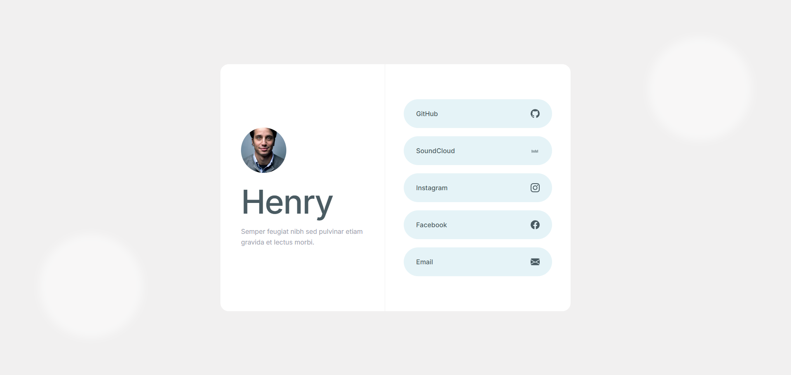

# Henry - Interactive Profile Card

A modern, responsive profile card component built with clean HTML5 and CSS3. This project focuses on creating a split-layout design using CSS Grid, perfect centering with Flexbox, and smooth hover micro-interactions.

## 📸 Preview

*(Tip: Take a screenshot of your project, upload it to GitHub, and add the image link here!)*

## 🚀 Features

- **Modern Split Layout:** Uses CSS Grid (`1fr 1fr`) to create perfectly equal left and right sections.
- **Perfect Centering:** Utilizes Flexbox to ensure the content and buttons are perfectly centered within their respective sections.
- **Responsive Design:** Automatically stacks into a single column on mobile devices using Media Queries.
- **Soft UI Design:** Features a soft gray background, blurred background circles, and soft drop shadows for a modern aesthetic.
- **Hover Interactions:** Social links smoothly scale up and change background color when hovered over.
- **Inline SVGs:** Used for crisp, scalable icons that load instantly.

## 🛠️ Built With

- **HTML5** - Semantic structure.
- **CSS3** - CSS Grid, Flexbox, Transitions, Media Queries.
- **Google Fonts** - Using the 'Inter' font family for clean typography.

## 🧠 What I Learned

Building this project helped me improve my layout skills:
- **Grid vs. Flexbox:** Learned how to use CSS Grid for the main 2-column layout, and Flexbox to center the content inside those columns.
- **`vh` vs `px`:** Learned why using fixed pixel heights (`min-height: 500px`) is safer for UI components than using viewport height (`vh`), which can break on different screen sizes.
- **CSS Transforms:** Practiced using `transform: scale()` and `transform: translateY()` to create smooth, non-jarring hover effects.

